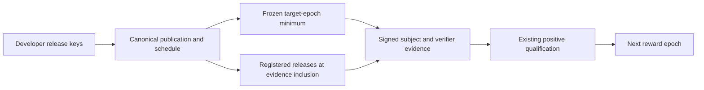

# Service release admission — research and isolated prototype

Owner: Sw0rdfish. Status: **Draft; not a production activation proposal**.

## Scope and first findings

Baseline: `qwertycoin-org/qwertycoin` default branch `main`,
`5a834c2e95ced1b6285605ea9282776fcbe0d382` (2026-10-20). No open PRs or
issues were returned during preflight. Existing secure-updater, release-DNS,
telemetry and governance branches are not authorization to change consensus.
This work does not merge those branches or change production configuration.

Published stable source references inspected separately:

| Tag | Commit |
| --- | --- |
| v2.0.4 | `1e479cc9feda48e07dd07ba6abcb89ca3934b5e2` |
| v2.0.5 | `f1db1c0df16b180c608d609a6e5966c701d1c292` |

Publication is not evidence of deployed Mainnet software. No production-node
inventory or operator telemetry is available to this investigation.

The current endpoint descriptor's `uint8_t service_version` is a protocol
version, not a release ordinal. `service_producer_v2.cpp` sets it to
`EPOSE_PROTOCOL_VERSION_V2`. It must not be repurposed. Existing receipt
subject/verifier signatures bind the challenge and response hash, but do not
contain software release IDs (`service_receipt_v2.{h,cpp}`).

`membership_pipeline_v2::apply_authenticated_receipt` checks frozen membership,
endpoint commitment, round/anchor/inclusion window, selected verifier and both
signatures. `close_qualification` requires distinct selected verifiers in enough
rounds. Therefore positive qualification is the appropriate extension point;
introducing a negative ban registry solely for updates is unnecessary.

The compiled profile uses epoch length 720, anchor depth 60, committee cap 9,
nominal threshold 6, three rounds at offsets 0/200/400 and two required rounds.
The actual threshold is `n - n/3` for `n=min(9,population-1)`; one identity alone
cannot qualify. Admission is RandomX with 18 leading zero bits and is not staking.

## Options and working decision

| Option | Trade-off |
| --- | --- |
| A: compiled minimums | Smallest authority surface; every new minimum needs validator rollout. Suitable fallback. |
| B: negative quorum certificates | Reuses Oxen's architecture there, but Qwertycoin would need new state changes and trust assumptions. Not a drop-in 7/10 solution. |
| C: bounded authorized chain records | Explicit developer authority; deterministic replay and later release changes without another generic-policy binary upgrade. More initial consensus work. |
| D: DNS/HTTP/GitHub decisions | Reject as a consensus source: validators can see inconsistent or unavailable data. Mirrors/notifications only. |

Prototype C while retaining existing positive service qualification. This is
centralized release authorization, **not decentralized release governance**.
It cannot install unknown service functions, record formats or consensus rules
into an old validator. Bootstrap and later protocol upgrades still need rollout.

### Proposed integration flow (not yet wired into the daemon)

Off-chain service checks still establish only what a verifier observed. Optional
DNS/HTTP/GitHub mirrors are not inputs to the above consensus derivation.

## Safety boundary

| Goal/attack | Guarantee |
| --- | --- |
| Unmodified obsolete official service continues qualifying | New-format signed evidence and target-epoch admission will exclude it after bootstrap. |
| Unauthorized official release or invented high ID | Registry and independent authority signatures; not `id >= minimum` alone. |
| Local minimum changed | Does not change independent validators. |
| Old code claims a real new ID | **Not prevented** by a signed self-claim or build hash. |
| Missing externally verifiable function | Test the actual service behavior; no cosmetic constant challenge. |
| Conforming modified fork | Remains permitted in an open protocol. |
| Exact unmodified binary execution | Not established. No universal secret, DRM or remote-attestation claim. |

Canonical block fetching provides a real verifier-side byte/hash check. The
chain verifies the signed transcript, not a historical network transfer.
Colluding subject/verifier keys can sign claims without doing the transfer.
Memory-leak and internal-scheduler fixes generally cannot be proven remotely.

## Delivery plan and review boundaries

1. Pin the full Qwertycoin and historical/current Oxen paths and activation math.
2. Specify bounded release records, target-epoch binding, authority rotation and
   recovery constraints, cancellation and pre-activation newer releases.
3. Implement an **isolated**, test-only policy/receipt prototype using existing
   crypto and test infrastructure; preserve the production wire protocol.
4. Record actual tests and remaining integration gates. Do not call a standalone
   state-machine test a live multi-daemon rollout.

No Mainnet H0, production release IDs, private release keys, releases,
deployments, emission changes or automatic binary updates are authorized here.
The critical-update single-release exception needs a separate explicit review
decision and is not silently enabled. Review owner: Sw0rdfish.

Production completion requires a versioned carrier/receipt integration, shared
validation/diagnostics derivation, state commitment migration and restart/reorg
proof, a reproducible isolated multi-daemon rollout and reviewed authority/H0
choices. The PR remains Draft until those validation gates are satisfied.

## Concrete state machine (prototype C)

The executable model lives only under `tests/epose/prototype/`; it is linked only
into `epose_unit_tests`. Neither `src/epose`, daemon, compiled Mainnet parameters,
RPC nor transaction parsing calls it. It is a **research state machine**, not a
secretly enabled testnet fork. Its configuration explicitly requires TESTNET,
nonzero optional H0 and an independently supplied test genesis/parameter hash.

### Registry, publication, schedule and lock

- IDs are `uint64_t`, strictly increasing, never reused, with an explicit stable
  predecessor. They need not be consecutive. IDs are not protocol versions.
- `publish` appends one immutable numeric ID / label / predecessor entry. First
  predecessor is zero; subsequent predecessor must equal the last published ID.
  ASCII labels have exactly three nonempty decimal components separated by dots,
  at most 32 bytes. No numeric comparison or implicit SemVer predecessor occurs;
  prerelease/build suffixes are rejected rather than moved into a stable window.
  Duplicate labels/IDs and missing predecessors are rejected. RC metadata stays
  outside this register. Leading zero components do not create numeric semantics.
- `schedule` chooses a registered stable head and target service epoch E. Its
  predecessor is the floor. **Registered newer stable releases** are also allowed
  early, including when published after that epoch's lock. Registration must
  exist in the canonical prefix at the receipt's inclusion height. A fabricated
  higher ID, zero ID, missing ID or not-yet-published ID is rejected. Later
  publication cannot rescue an earlier invalid receipt on historical replay.
- Lock `L(E)=start(E-1)-1`, BEFORE the first admission-context block. Records
  through L(E) determine E's binding; that binding cannot change on descendants
  merely because another release was announced. The **minimum window** is
  frozen; the publication register can grow monotonically. Newly registered
  stable releases above the frozen floor are allowed for subsequent evidence,
  without changing that floor/hash or invalidating any existing proof. The
  receipt inclusion height is explicit in this lookup, even if a test/replay
  object already holds later publications; there is no future-register shortcut.
- For every scheduled change included at Hp, enforce `L(E)-Hp >= notice`, using
  checked ordering/subtraction rather than potentially overflowing addition.
  The policy is known before admission, freeze, anchor and round zero. H is
  `start(E)`, not the policy inclusion height or a wall-clock date.
- Schedules form strictly increasing epochs and stable heads. Multiple pending
  publications/schedules are possible; a subsequent publication alone does not
  alter a scheduled floor or shorten anyone's notice. The first schedule must
  target the configured first enforced epoch and must have a real predecessor.
- `cancel` may cancel **only the latest uncancelled schedule**, and only before
  its lock with the same minimum notice. Initial bootstrap schedule cannot be
  cancelled. Replace it by an explicit later announcement, not mutable DNS.
  Cancellation never modifies a closed/frozen past epoch. A replacement schedule
  has its own full notice. Cancellation history remains part of the policy hash.
- Published releases are immutable and cannot be silently relabelled, deleted or
  reused. This prototype has **no release withdrawal or emergency single-release
  opcode**. A bad pending floor may be cancelled as above. An already admitted
  faulty release cannot be retrospectively excluded with this limited vocabulary;
  recovery requires a later normal window or a separately reviewed protocol
  change. This intentionally exposes, rather than hides, the emergency trade-off.

A frozen epoch view returns head, minimum, lock, last included policy sequence
and a binding hash of context, target epoch, lock and last included record hash.
Only registry membership at the receipt inclusion height plus this frozen view
determines release eligibility. Later publication never changes earlier heights.
DNS,
HTTP, peer version lists, the current GitHub release and descriptor caches are
not inputs. Canonical release metadata is carried in full, not only a hash.
The parameter-set hash must commit the reviewed production configuration at
integration; test contexts are intentionally unrelated to production manifests.

### Canonical prototype wire format

Not an allocated transaction-extra type. All integers below are unsigned;
`u64` means eight little-endian bytes, `u8` one byte. Hash/public key = 32 raw
bytes, signature = existing 64-byte `crypto::signature`. No struct dumps,
native integers, JSON normalization or variable-length integer ambiguities.

| Order | Field |
| --- | --- |
| 1 | eight ASCII bytes `QWCRP001`, u8 schema (=1), u8 operation (1–4) |
| 2 | u64 sequence (starts at 1), previous full-record hash (zero initially), u64 key generation (starts at 0) |
| 3 | u64 release ID, u64 predecessor, u8 label length, label bytes (0–32) |
| 4 | u64 target epoch, u64 cancellation-reference sequence |
| 5 | three public keys for rotation, u8 current signer mask, u8 new signer mask |
| 6 | three current signatures, three new signatures (unused slots all zero) |

Unused operation fields must be zero/empty, not arbitrary authenticated padding.
Masks must select 2 or 3 of the three fixed distinct keys. No repeated indices,
unknown high mask bits, missing signature or nonzero unused slot. Reject unknown
schema/opcode, truncation, trailing bytes, oversized input and noncanonical unused
fields. Maximum encoded policy is 605 bytes (573 + label), parser cap 768.

Signing domain `QWC_RELEASE_POLICY_1` includes network enum, genesis hash,
parameter-set hash and all fields through the signer masks, before signatures.
Full-record hash has independent `QWC_RELEASE_POLICY_RECORD_1` domain and includes
all signature slots. The canonical first valid continuation wins in chain order;
another record with the same sequence/conflicting predecessor is invalid, not an
alternative local policy. Signatures from ordinary GitHub accounts are unrelated
to protocol release-authority signatures.

The prototype receipt wrapper has magic `QWCRR001`, schema 1, the explicit legacy
challenge/response/two signatures, subject ID, verifier ID, frozen policy hash,
and two additional claim signatures. Total 587 bytes. Subject claim domain
`QWC_RP_SUBJECT_CLAIM_1` binds context, schema, complete legacy transcript hash
including its verifier signature, both claimed IDs and epoch policy hash.
Verifier claim domain `QWC_RP_VERIFIER_CLAIM_1` additionally binds subject claim.
Thus a verifier cannot insert an unsupported subject ID into a challenge and
pretend the subject asserted it. Existing signatures/domains remain byte-for-byte
unchanged; this deliberately nonoptimal four-signature wrapper lets tests reuse
the actual membership/qualification implementation without trusting a bypass API.
A production format can use two new-domain signatures after full protocol review.
No such reduction is implemented or claimed here.

`apply_receipt` checks both claimed IDs, binding and claim signatures, then calls
the existing fully authenticated membership receipt validator. It does not change
committee selection. A stale verifier cannot count toward a new subject's required
coverage; its own rewards still require its own admissible subject evidence.
This may cause qualification loss during a population-wide slow rollout. There is
no automatic threshold reduction or committee reset beyond existing small-network
rules. Do not make a negative ban list or operator-address control a side effect.

### Authority and bounded recovery

Test policy uses ordinary existing cryptographic signatures, **2 of 3 independent
keys**, not a new threshold signature algorithm. All three configured keys and
all three proposed rotation keys must be distinct, canonically encoded,
non-identity points in the prime-order subgroup, including any slot not selected
by the signature mask. Curve decoding alone (`crypto::check_key`) is insufficient:
the identity permits signatures using the publicly known zero scalar and can
reduce a nominal 2/3 authorization to one real signing secret. Reuse the existing
RingCT subgroup check with an explicit identity rejection; no new cryptographic
primitive is introduced. Invalid key sets must be rejected before accepting
signatures from that set, without advancing policy sequence or key generation.
Distinct custodians/locations are operational requirements, not cryptographic facts.
Lead developers authorize official service releases. Their technical powers are
publication, forward two-release-window scheduling, bounded pending cancellation
and key rotation. They cannot write node IDs, wallet addresses, emission, PoW,
chain selection, arbitrary bytecode or per-node exclusions. They can nevertheless
harm liveness by authorizing bad software or forcing very frequent windows;
limited powers are not harmless powers.

Rotation needs 2/3 old signatures **and 2/3 new signatures** over the same
new-key set and next generation; unused slots must be zero. Generation advances
one at a time when the record is included; replay/undo reconstructs it. No
independent emergency super-key, expiry bypass or recovery service exists. One
lost key is tolerated; loss/compromise of two cannot be repaired by silently
lowering the threshold. The bounded recovery is remaining-quorum rotation when
possible, otherwise explicit protocol/governance rollout outside this mechanism.
Compromised threshold authority can rotate maliciously; no on-chain mechanism can
cryptographically distinguish it from authorized use.

Offline private key custody, independent signer review of canonical payload,
public manifest and backups must be agreed before production. No private release
keys were created for deployment; tests generate ephemeral **test-only** keypairs
in process and never serialize or commit their secrets. Mainnet authority keys,
H0 and bootstrap IDs are intentionally absent.

### Bounds, undo and limitations

At most one policy record per synthetic block, 768 bytes before parsing,
three current signature checks (plus three new on rotation), label 32 bytes,
4096 policy records total and 128 retained undo blocks. Bootstrap and each
proposed rotation also validate all three public keys, including subgroup
checks; production resource accounting must include that work. After the research cap,
additional records fail closed; this is **not a final production lifetime-cap
policy**. Canonical history is retained for reproducibility; scans are bounded by
that cap (cancellation lookup uses a set, not nested history scans). Tip undo
removes appended records; deeper rollback explicitly requires replay. No clock,
external I/O, user-controlled allocation counts or signature lists enter validation.
Unsigned monotonic IDs may exhaust at UINT64_MAX but cannot wrap to reuse an ID.
Sequence growth is bounded by the archive cap; timing uses existing checked math.

The model's block input is a canonical ordered byte list, not PoW chain selection.
It does not independently decide which competing chain is valid. Production
integration must atomically journal policy plus service state, include policy in
versioned state commitments, preserve pre-H0 commitments exactly and support
LMDB restart/rescan. A standalone replay of this model is not that migration.

## Remaining decision record

The following are explicit review decisions for Sw0rdfish, not silently selected
Mainnet defaults:

1. Approve C and centralized developer authorization, or choose A's periodic
   validator rollouts; do not introduce B without a separate security argument.
2. Approve a 2/3 custodian process, concrete public keys, rotation/recovery limits
   and public disclosure of authority rights; no credentials needed in a PR.
3. Approve exact bootstrap release identities and preparatory compatible release
   names after artifact review. Existing published releases cannot be relabelled
   into compatibility. Test IDs do not reserve production IDs.
4. Review the lock-before-admission rule, minimum/normal notice, early-new-release
   behavior, cancellation-only recovery and liveness under stale committees.
5. Decide separately whether a narrowly bounded emergency single-release rule is
   needed; absent approval it remains unavailable, including in the prototype.
6. Only after integration/migration and multi-daemon evidence: select H0 per
   network in a reviewed candidate. Mainnet remains unconfigured.
